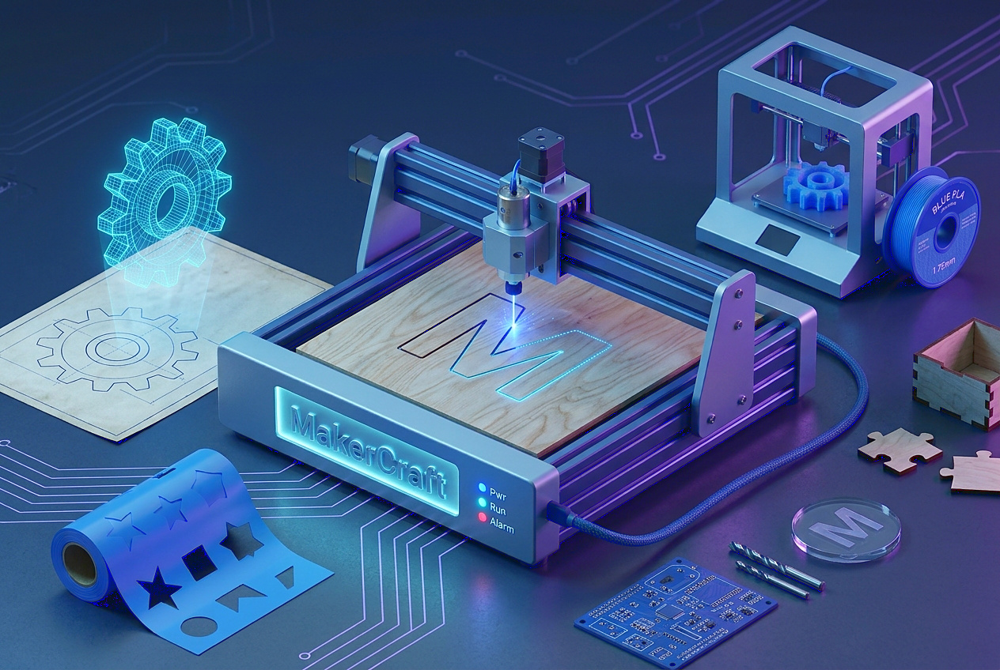
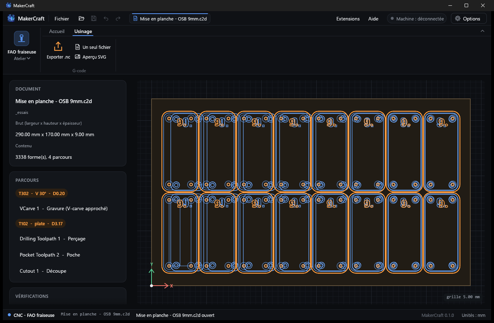

  

<h1 align="center">MakerCraft</h1>

  <b>Atelier 2D/3D pour makers : CNC, laser, PCB et pilotage de machines.</b> 
  <i>2D/3D workbench for makers: CNC, laser, PCB and machine control.</i>

  
  
  

  

## Présentation / Overview

MakerCraft réunit dans une seule application des **ateliers** que l'on choisit d'un clic, comme les espaces de travail des logiciels de CAO :

- **CNC** : DAO/CAO, FAO fraiseuse, usinage 3D, gravure d'images
- **Laser**
- **PCB**
- **Machines** : pilotage de la fraiseuse, du laser et des périphériques

Chaque atelier pourra aussi fonctionner seul.

*MakerCraft gathers several workshops (CNC, laser, PCB, machine control) in one application. Each workshop will also run standalone.*

   
  Atelier FAO fraiseuse, version de développement / CNC milling workshop, development build

## Statut / Status

En développement, pas encore diffusé : le code sera publié ici avec la première version utilisable.

*In development, not yet released: the source code will be published here with the first usable version.*

## Liens / Links

- Site : [makercraft.fe-be.fr](http://makercraft.fe-be.fr)
- Contact : makercraft@fe-be.fr
- Soutien / Support : [Patreon FeBeSoft](https://www.patreon.com/c/FeBeSoft) (le logiciel est et restera gratuit / the software is and will remain free)

Licence prévue / Planned license : GPL-3.0

---

Un projet <a href="https://fe-be.fr">FeBe</a> - logiciels libres pour makers

