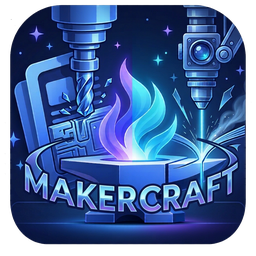
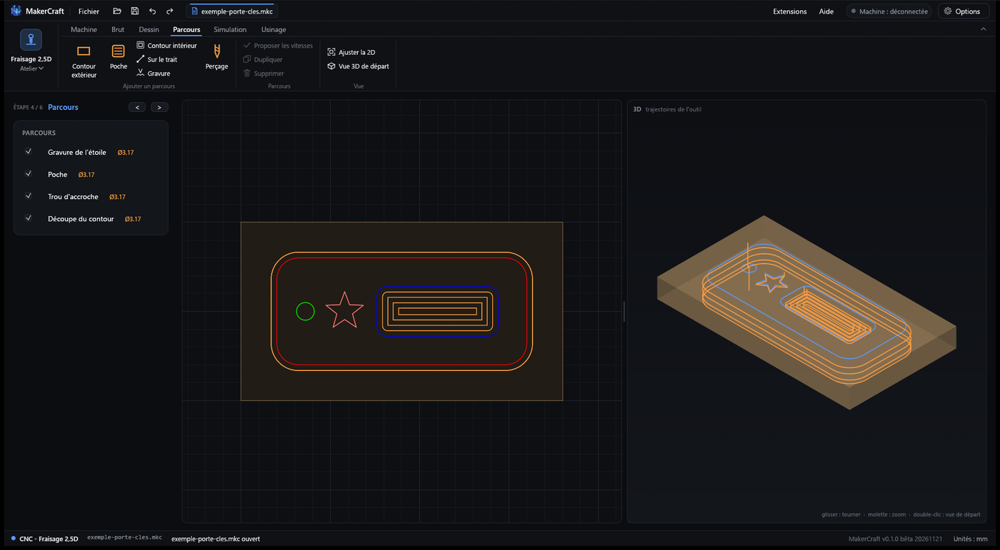
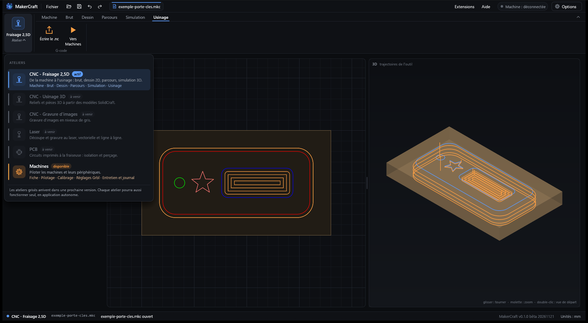
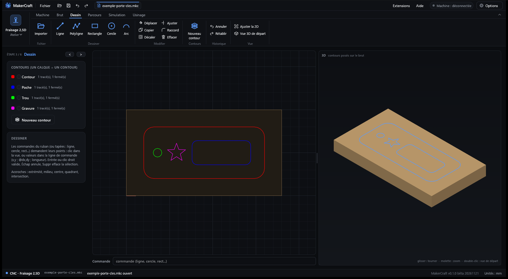
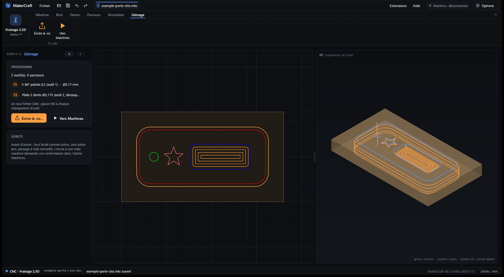
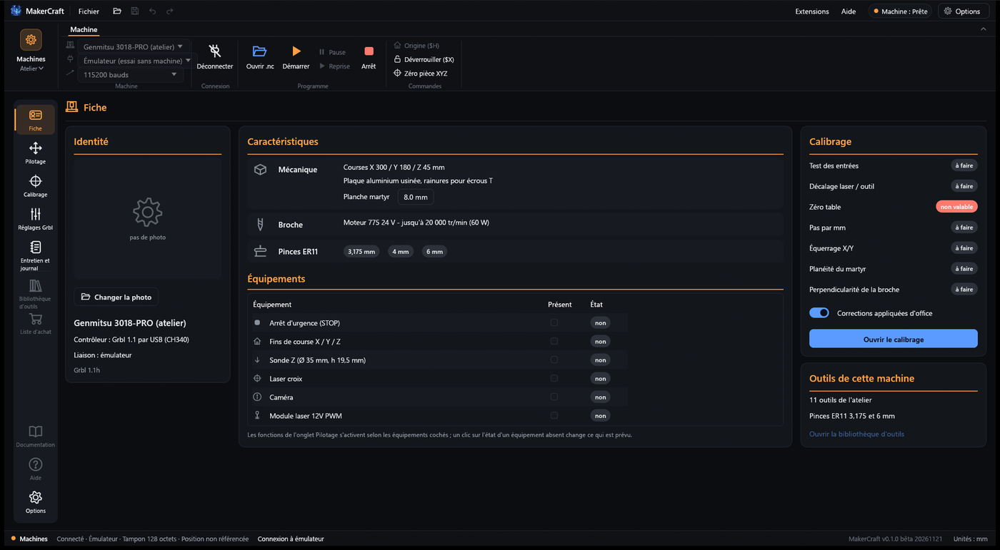
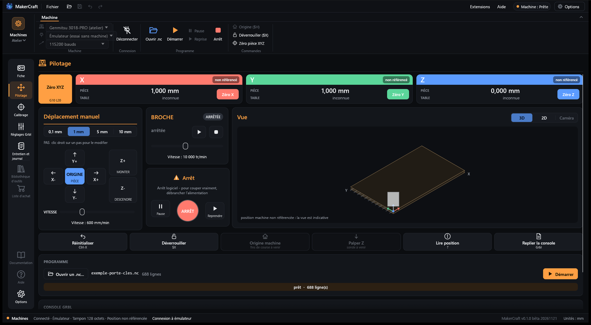
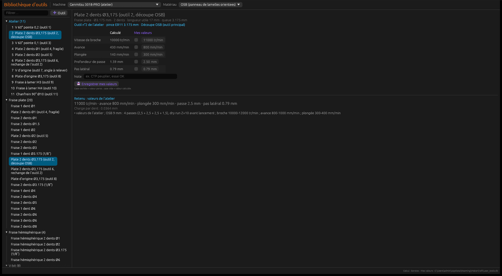

<p align="center">
  
</p>

<h1 align="center">MakerCraft</h1>

<p align="center">
  <b>Atelier 2D/3D pour makers et classes de technologie : CNC, laser, PCB et pilotage de machines.</b><br>
  <i>2D/3D workbench for makers and technology classes: CNC, laser, PCB and machine control.</i>
</p>

<p align="center">
  <a href="https://github.com/FeBeSoft/makercraft/releases/tag/v0.1.1-beta.20261128"></a>
  
  
  
</p>

<p align="center">
  
</p>

## Version test / Test release : v0.1.1 bêta 20261128

**[Télécharger la version test](https://github.com/FeBeSoft/makercraft/releases/tag/v0.1.1-beta.20261128)** (Windows 10 / 11, 64 bits). Nouveautés : [notes de version](docs/versions/v0.1.1-beta.20261128.md) ; historique complet : [CHANGELOG](CHANGELOG.md).

C'est une **préversion** : tout n'est pas fini, et elle sert surtout à recueillir vos avis. Essayez-la d'abord **avec l'émulateur intégré**, sans machine réelle. Ne l'utilisez pas encore pour un travail qui compte.

*This is a **pre-release** for feedback. Try it first **with the built-in emulator**, without a real machine, and do not rely on it for real work yet.*

MakerCraft réunit dans une seule application des **ateliers** que l'on choisit d'un clic, comme les espaces de travail des logiciels de CAO : CNC, laser, PCB et pilotage des machines. Chaque atelier pourra aussi fonctionner seul. Le logiciel est **libre (GPL-3.0) et gratuit**, et le restera.

<p align="center">
  
</p>

## Ce qui fonctionne déjà

### Atelier CNC - Fraisage 2,5D

Six étapes, dans l'ordre de fabrication, une par onglet du ruban :

- **Machine** : la machine de la banque (Genmitsu 3018-PRO pour l'instant), ses courses.
- **Brut** : dimensions, matière, zéro pièce, zones de bridage interdites à l'outil.
- **Dessin** : le moteur de dessin de CadCraft, avec un ruban à groupes et des variantes au clic droit (cercles, arcs, ellipses, polygone, étoile, oblong, points de perçage...), une sélection à poignées façon Carbide Create (déplacer, mettre à l'échelle, tourner), la boîte des cotes façon Galaad (Entrée), les Propriétés, des réseaux qui restent liés à leur forme d'origine, l'édition des nœuds, les dégagements dogbone et T-bone, les aides au tracé (accroches, grille, ortho, polaire, calculs comme `W/2+5`), les lignes de construction et les cotes. Import DXF / DWG. Un calque = un contour à usiner, dans un arbre avec visibilité, verrou et commentaires.
- **Parcours** : contour extérieur ou intérieur, sur le trait, poche, perçage, gravure. L'outil se choisit dans chaque parcours, et la banque d'outils propose les vitesses.
- **Simulation** : contrôle des passages dans les brides, de la profondeur et de la durée.
- **Usinage** : écriture du G-code Grbl, avec le rappel de l'outil et de la pince ER11 à chaque changement d'outil, et envoi direct vers l'atelier Machines.

Les projets sont enregistrés en `.mkc`. Un exemple est fourni : `exemple-porte-cles.mkc`.

<p align="center">
  
  
</p>

### Atelier Machines

- **Fiche** : la machine, sa mécanique, sa broche, ses pinces, et les équipements installés (arrêt d'urgence, fins de course, sonde, laser croix, caméra...). Les commandes s'activent selon ce qui est coché.
- **Pilotage** : position pièce et table, zéro par axe, déplacement manuel à la souris ou au clavier, broche, arrêt logiciel, vue 3D / 2D, envoi d'un programme, console Grbl.
- Grbl 1.1 / grblHAL par port USB, ou par l'**émulateur intégré** (choisi par défaut).
- Alarmes et erreurs Grbl **expliquées en français**, avec la cause probable et quoi faire.
- Sur une vraie machine sans zéro valable, les déplacements longs demandent une ou deux validations.

<p align="center">
  
  
</p>

### Bibliothèque d'outils (`makercraft-outils.exe`)

Le profil de la Genmitsu 3018-PRO, les 11 outils de l'atelier avec leur pince ER11, et des valeurs de coupe éprouvées pour l'OSB, le MDF, le contreplaqué, la mousse et l'acrylique.

<p align="center">
  
</p>

## En cours

- **Machines** : calibrage avec assistants (zéro table, équerrage, planéité du martyr), réglages Grbl (lecture, explication, sauvegarde), entretien et journal, caméra, palpage.
- **CNC** : simulation de l'enlèvement de matière, ponts d'attache, V-carve, rampes d'entrée, fonctions de dessin de Carbide Create.
- Bibliothèque d'outils intégrée à l'atelier Machines, fournisseurs et liste d'achat.

## Prévu

- **v0.2** : la Genmitsu 3018-PRO pleinement utilisable, avec au moins les fonctions de Carbide Create.
- **v0.3** : la fraiseuse Isel CPM 2018.
- Ensuite : usinage 3D, gravure d'images, laser, circuits imprimés (PCB).
- L'import des dessins de la suite Galaad est envisagé, pour les ateliers de technologie qui en ont encore.

## Un logiciel, deux usages

Le mode se choisit dans **Options > Général**.

- **Maker** : seul à l'atelier ou au fablab, tout est accessible.
- **En classe (prof / élève)** : le prof garde la main sur les réglages et la machine, l'élève prépare et lance son travail dans un cadre sûr. En mode élève, la fiche machine est en lecture seule, les réglages sont masqués, les pas et la vitesse de déplacement sont limités, la broche, le déverrouillage, la console et le lancement d'un programme sont réservés au prof.

**Échanges avec les élèves par le Nuage du prof** (prévu) : l'élève dépose son projet `.mkc` par un simple lien de dépôt, sans compte, dans le Nuage apps.education du prof (WebDAV) ; le prof le retrouve dans MakerCraft, dans une file d'attente avec la durée de chaque usinage. Aussi prévus : passage en mode prof par mot de passe, option « maker seulement », validation du prof avant usinage, modèles de projets prêts à l'emploi.

> **Aperçu** : dans cette version, le mode élève n'est pas protégé par un mot de passe (un élève peut repasser en mode maker) et ne remplace jamais la surveillance de l'enseignant. Il est là pour recueillir vos avis.

## Donnez votre avis

Chaque retour compte, même court : une capture et deux lignes suffisent. Les idées des utilisateurs décident de ce qui arrive dans la v0.2.

- **Par courriel** : [makercraft@fe-be.fr](mailto:makercraft@fe-be.fr) (avec les informations de version : À propos > « Copier les informations de version »).
- **Sur GitHub** : une question ou une idée dans les [Discussions](https://github.com/FeBeSoft/makercraft/discussions) ([Questions et entraide](https://github.com/FeBeSoft/makercraft/discussions/categories/questions-et-entraide), [Suggestions](https://github.com/FeBeSoft/makercraft/discussions/categories/suggestions)...), un bug précis dans les [issues](https://github.com/FeBeSoft/makercraft/issues/new/choose).
- **Pour suivre le projet** : [Facebook FeBeSoft](https://www.facebook.com/FeBeSoft) et [Patreon FeBeSoft](https://www.patreon.com/c/FeBeSoft).

À essayer en priorité :

1. L'installation et le premier lancement.
2. Ouvrir `exemple-porte-cles.mkc`, ou importer un DXF, créer des parcours et écrire le G-code.
3. Se connecter à l'émulateur et jouer le programme.
4. Avec une machine Grbl : seulement **lire** son état au début, sans usiner. Décrivez-la dans [Machines](https://github.com/FeBeSoft/makercraft/discussions/categories/machines) (modèle, courses, broche, pinces) pour enrichir la banque de machines.
5. Vos outils et leurs conditions de coupe dans [Outils](https://github.com/FeBeSoft/makercraft/discussions/categories/outils).
6. Enseignants : votre avis sur le mode élève et sur l'échange par le Nuage, dans [En classe](https://github.com/FeBeSoft/makercraft/discussions/categories/en-classe).
7. Ce qui est clair, ce qui ne l'est pas, ce qui manque par rapport à Carbide Create ou à vos logiciels habituels.

## Installation

1. Téléchargez `MakerCraft-v0.1.0-beta.20261121-windows-x64.zip` depuis la [page de la version](https://github.com/FeBeSoft/makercraft/releases/tag/v0.1.0-beta.20261121) et décompressez-le où vous voulez.
2. Lancez `makercraft.exe`. L'exécutable n'est pas encore signé : Windows SmartScreen peut afficher un avertissement ; cliquez sur « Informations complémentaires », puis « Exécuter quand même ».
3. Pour une 3018 en USB, installez le pilote CH340 si Windows ne reconnaît pas le port.

Rien n'est installé ailleurs : les réglages sont dans `%APPDATA%\FeBe\MakerCraft`. MakerCraft ne fait **aucune connexion réseau** de lui-même : seul le bouton « Mettre à jour », quand on clique dessus, demande à GitHub la dernière version publiée (et au démarrage si l'option, non cochée par défaut, est activée).

## English summary

MakerCraft is a free (GPL-3.0) workbench for makers and technology classes. This **test release** (Windows 10/11, 64-bit) includes the CNC 2.5D milling workshop (drawing, DXF/DWG import, toolpaths, checks, Grbl G-code), the Machines workshop (machine sheet, jog, spindle, program sending, emulator, Grbl alarms explained) and the tool library. A classroom mode (teacher / pupil) is available as a preview, without password yet. The interface is in French for now. Feedback is very welcome: questions in [Q&A](https://github.com/FeBeSoft/makercraft/discussions/categories/q-a), your machine in [Machine Profiles](https://github.com/FeBeSoft/makercraft/discussions/categories/machine-profiles), your cutting tools in [Tools](https://github.com/FeBeSoft/makercraft/discussions/categories/tools), bugs in the [issues](https://github.com/FeBeSoft/makercraft/issues/new/choose), or by email at [makercraft@fe-be.fr](mailto:makercraft@fe-be.fr).

## Développement / Development

Prérequis : Rust ≥ 1.95 (MSVC sous Windows), Git.

```
cargo build --release -p makercraft -p makercraft-outils   # -> target\release\
cargo test
cargo xtask ci          # fmt + clippy + tests, avant chaque commit
```

```
crates/core/   noyau sans métier : geom, ext-api (contrat d'extension, commandes, hôte)
crates/ext/    extensions : machine, c2d, cam, dao (CadCraft), cao (SolidCraft), mkc (projet), tooldb
apps/          makercraft (application), makercraft-outils (bibliothèque d'outils), c2d_to_nc,
               makercraft-send (console et envoi de G-code), makercraft-cli, makercraft-c2d
banque/        banque d'outils, de matériaux et de machines (TOML, compilée en SQLite)
```

Règles : jamais de `unwrap` / `expect` hors tests, pas d'`unsafe` ; tout est une commande `extension.action` ; le noyau ne dépend d'aucune extension ; le code amont n'est jamais modifié. Détails : [`docs/architecture.md`](docs/architecture.md), projets amont : [`UPSTREAM.md`](UPSTREAM.md).

Interopérabilité : MakerCraft lit les fichiers d'autres logiciels dans le respect de l'article L122-6-1 du Code de la propriété intellectuelle, sans copie de leur code ni contournement de protection. Projet indépendant, non affilié à ArtCraft / Storyteller, aux auteurs de SolidCraft ni à Carbide 3D.

## Remerciements / Credits

- [CadCraft](https://github.com/storytold/cadcraft) et [SolidCraft](https://github.com/tangency-labs/solidcraft), dont MakerCraft utilise le moteur de dessin, la lecture DXF et le noyau 3D
- [LaserGRBL](https://github.com/arkypita/LaserGRBL), [Candle](https://github.com/Denvi/Candle) et [Universal G-Code Sender](https://github.com/winder/Universal-G-Code-Sender), dont le pilotage des machines Grbl s'inspire
- [Grbl](https://github.com/gnea/grbl) et [grblHAL](https://github.com/grblHAL)
- Emil Ernerfeldt et les contributeurs d'[egui / eframe](https://github.com/emilk/egui)
- les concepteurs de la suite Galaad, qui a équipé tant d'ateliers de technologie
- les équipes de Rust, serde, rusqlite et geo

## Liens / Links

- Site : [makercraft.fe-be.fr](https://makercraft.fe-be.fr)
- Contact : [makercraft@fe-be.fr](mailto:makercraft@fe-be.fr)
- Soutien / Support : [Patreon FeBeSoft](https://www.patreon.com/c/FeBeSoft) (le logiciel est et restera gratuit / the software is and will remain free)

Licence : GPL-3.0-or-later (voir [`LICENSE`](LICENSE)). Les composants MIT / Apache intégrés gardent leur licence.

---

<p align="center">Un projet <a href="https://fe-be.fr">FeBe</a> - logiciels libres pour makers</p>
